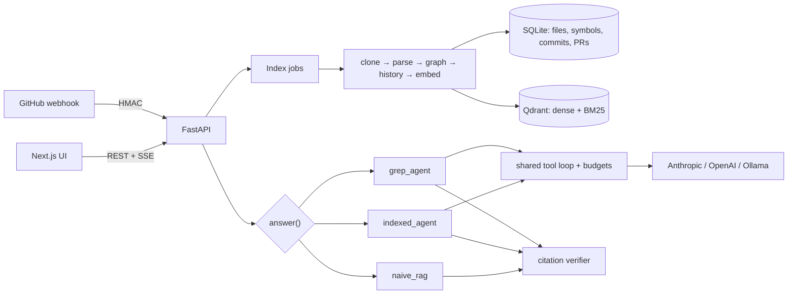

# CodeAtlas

> Ask questions about an unfamiliar Python codebase and get answers with exact `path:start-end` citations, call-chain traces and commit → PR → issue history — plus a fair experiment on whether a pre-built index actually beats an agent that just greps.

 <!-- GIF placeholder: record add repo → ask → click citation → tour -->

**Status (2026-10-27):** all ten build phases are implemented and tested (315 backend tests, 15 Playwright smoke tests). **No real evaluation numbers exist yet**: the 180 drafted eval questions are awaiting human review, and the experiment needs an `ANTHROPIC_API_KEY`. See [PROGRESS.md](PROGRESS.md) for exactly what has and hasn't been run, and [DECISIONS.md](DECISIONS.md) for every design decision and dead end.

---

## What it does

- **Code Q&A with citations.** Every claim points at `[path:start-end]`; a verifier checks every citation and backticked identifier exists, and gives the model one revision pass if not. Citation chips open a side panel with the exact lines highlighted.
- **Flow tracing.** A static call graph (tree-sitter + best-effort resolution of imports, `self.method()`, `super()`, simple local types) backs `find_callers` / `find_callees`.
- **History-aware answers.** `git_blame` → `get_commit` returns the commit message plus the pre-linked PR description, review comments and linked issues.
- **Onboarding tour.** Entry points (routes, CLIs, console scripts, `__main__`), central classes (PageRank over the call graph), data models and a suggested reading order with citations; works without an LLM.
- **Team service.** FastAPI backend, Next.js UI, background index jobs with live progress, GitHub push webhook for incremental re-indexing. Answers stream token by token, with the agent's tool steps shown live.

## Architecture



Full diagram, request flow and trust boundaries: [docs/architecture.md](docs/architecture.md).

## The research question

> For codebase Q&A, how does an **index-first** approach (hybrid index + code graph + pre-linked history) compare to an **explore-on-demand** approach (an agent with only grep, file reads and git, like agentic coding tools) on correctness, cost, latency and "why was this changed" questions?

Three systems behind one interface (`System.answer(repo_id, question, config)`):

| System | What it gets |
|---|---|
| `naive_rag` | fixed-size chunks, dense retrieval, one LLM call (weak baseline) |
| `indexed_agent` | hybrid search (dense + BM25, RRF) + reranker, code graph tools, history tools; every component is a flag for ablations |
| `grep_agent` | grep (ripgrep), read, list, git log/blame/show; optional `grep_agent_github` adds a PR lookup for the fairer history comparison |

Fairness controls: same model, same step budget (10 tool calls), same token budget, same tool-output truncation, same file corpus (grep results are filtered to the indexed file set), same verifier. The Anthropic API no longer accepts `temperature`, so determinism can't be forced for Claude — run-to-run variance has to be measured (see Limitations).

### Datasets

`eval/datasets/{requests,flask,fastapi}.jsonl`, pinned to `psf/requests@611c6162`, `pallets/flask@d086db85`, `fastapi/fastapi@7a0a3f0b`. 60 questions each, 12 per category: `locate`, `explain`, `flow`, `why` (grounded in a real commit SHA), `unanswerable` (tests hallucination). Drafted by an LLM, checked by a validator (gold files exist at the commit, gold symbols defined, `why` answers cite real commits) — and **all `verified: false`** until reviewed by a human with `eval/review.py`. Only verified questions are used in runs.

### Results

**Not yet available.** No numbers below will be filled in until (1) the datasets are reviewed and (2) the experiments in BUILD_PROMPT §6.5 are run with a real model. When they are, this section is copied verbatim from [`eval/results/summary.md`](eval/results/summary.md), which `python -m eval.summarize` regenerates from the saved raw runs — every number traces to `eval/results/raw/<run_id>/` with its config, model and CodeAtlas version.

What *has* been run is a 5-question offline dry run (mock LLM, all three systems, real index) proving the pipeline end to end: [`eval/results/dryrun/summary.md`](eval/results/dryrun/summary.md). Its scores are meaningless by design; one real observation from it is that the cross-encoder reranker costs `indexed_agent` 10–20 s of CPU per question on a laptop.

### Judge calibration

**Not yet available** (no human grades exist). Procedure: `python -m eval.judge.export_calibration --n 30` writes a blind CSV; grade it 0/1/2 with `eval/results/calibration/RUBRIC.txt`; `python -m eval.judge.agreement` reports exact agreement, Cohen's kappa and quadratic-weighted kappa.

### Index-first vs explore-on-demand: what the experiment is set up to show

These are the hypotheses the design tests, **not results**:

- Index-first should win on `flow` and `locate` questions where the right code doesn't share words with the question (semantic search, call graph), and on cost when grep needs many round-trips.
- Explore-on-demand should be competitive on exact-identifier questions (one grep finds it) and has zero indexing cost and no staleness.
- `why` questions mostly measure access to PR/issue text, which is why `grep_agent_github` exists: without it the comparison would conflate "index vs grep" with "has GitHub vs doesn't".
- The reranker and the extra context of richer tools cost latency; the cost-vs-correctness chart is the deliverable, not a single winner.

## Honest limitations

- **Static call resolution is partial.** Of the calls that could point into the repo, 58.6% resolve on `psf/requests` (53.6% excluding tests) and only 40.8% on `pallets/flask` (38.1% excluding tests), where the top unresolved calls are methods on untyped objects such as pytest fixtures (`client.get` ×262, `app.route` ×154); builtins and external calls are counted separately. Unresolved: methods on untyped variables (`r.json()`), pytest fixtures, dynamic dispatch, `getattr`, decorators that replace functions, dependency injection.
- **Python only** for structure; Markdown/YAML/TOML/etc. are indexed as text. Public GitHub repos only.
- **No sampling control on Claude.** `temperature` is rejected by the API; repeated runs are needed to estimate variance.
- **The verifier checks existence, not relevance.** A real citation can still not support its claim; that's the judge's job.
- **Single-process service.** Rate limiting and job management are in-process; multiple workers would need shared state (e.g. Redis) and a trusted `X-Forwarded-For`.
- **History needs a token.** Unauthenticated GitHub access (60 req/h) linked only 15–47 commits per repo before falling back to lazy linking.
- **Local CPU embeddings are slow.** On a laptop CPU, indexing took ~17 min for `requests` (1,273 chunks) and ~55 min for `flask` (1,922 chunks), almost all embedding; `fastapi` (1,219 Python files, mostly `docs_src/`) takes hours. A GPU or API embeddings (`DENSE_EMBEDDING_PROVIDER=openai`) fix this.
- **LLM-judge scores** are only as trustworthy as the calibration, which hasn't been done yet.

## What I tried that didn't work

Short version (details and dates in [DECISIONS.md](DECISIONS.md)):

- `tree-sitter==0.26.0` segfaults on Windows mid-file (`child_by_field_name`); pinned 0.25.2.
- tree-sitter happily parses Python 2 without flagging errors, so validity comes from `ast.parse` (parse only).
- `str.splitlines()` splits on form feeds and U+2028, shifting line numbers vs git/tree-sitter.
- `executescript()` commits implicitly, so failing migrations were half-applied; then `split(";")` broke on a semicolon in a comment.
- PyDriller's per-file diffs would take ~7 minutes on requests; one `git log --name-only` takes a second.
- SQLite connections are thread-bound; moving work to threads broke until DB access was kept on the event loop.
- Python `re` can't be time-limited, so the grep fallback runs in a killable child process.
- A 60k token budget ran out after ~4 agent steps because the transcript is re-sent each step.
- Next.js 16.4.0 had a critical RCE advisory; TypeScript 7 doesn't work with Next's type-check; `NEXT_PUBLIC_*` is build-time only.
- Dataset-drafting agents stalled until told to write incrementally.

## Setup

Requirements: Docker. For local development also Python 3.11, [uv](https://docs.astral.sh/uv/) 0.13, Node 24, git.

### Run with Docker

```bash
cp .env.example .env          # set ANTHROPIC_API_KEY; GITHUB_TOKEN strongly recommended
docker compose up -d --build  # UI http://localhost:3000, API http://localhost:8000
```

Then add a repo in the UI (e.g. `https://github.com/psf/requests`). The first index downloads ~700 MB of embedding/reranker models into the `codeatlas_data` volume. Set `QDRANT_API_KEY` and `ADMIN_TOKEN` for anything beyond localhost.

Behind a TLS-intercepting proxy, put the proxy's root CA (PEM, `*.crt`) in `docker/certs/` before building.

### Local development

```bash
docker compose up -d qdrant
cd backend
uv sync --all-extras
uv run pytest                                   # 315 tests, ~3 min (no network or API keys needed)
uv run ruff check . && uv run ruff format --check .
uv run python -m app.cli index https://github.com/psf/requests --commit 611c6162cbc4ac2020a2f91c7cfa4f3abf9bbb60
uv run python -m app.cli ask psf__requests "How are retries configured?" --system indexed_agent
uv run uvicorn app.main:app --port 8000

cd ../frontend
npm ci && npm run dev                           # http://localhost:3000
npx playwright install chromium && npm run test:e2e   # offline smoke tests (mock LLM)
```

On networks that intercept TLS: `export UV_SYSTEM_CERTS=1`; for model downloads run `python scripts/export_ca_bundle.py data/ca-bundle.pem` and set `SSL_CERT_FILE` / `REQUESTS_CA_BUNDLE` to it; for npm set `NODE_EXTRA_CA_CERTS`.

### Evaluation

```bash
# from the repo root
uv run --project backend python -m eval.review eval/datasets/flask.jsonl          # verify questions (human)
uv run --project backend python -m eval.run --dataset eval/datasets/flask.jsonl --config configs/full.yaml --limit 5
uv run --project backend python -m eval.summarize
```

Configs for every system and ablation step are in [`configs/`](configs/). The runner prints a cost estimate and refuses to start above $2 without `--yes`; `--mock-llm` runs the whole pipeline offline.

## Security notes

Repository code is never imported, installed or executed. Clone URLs are strictly validated (`https://github.com/<owner>/<repo>` only), git runs with argument lists, no hooks and https-only transports, and every file access is path-checked against the checkout (no `..`, absolute paths, `.git` or symlink escapes). Repository text is treated as untrusted data in all prompts. The webhook verifies `X-Hub-Signature-256` and rejects replayed deliveries. Secrets are `SecretStr` and never logged.
