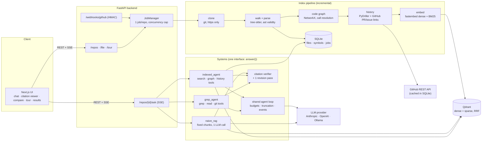

# CodeAtlas architecture

## Components

## Request flow: `POST /repos/{id}/ask`

1. The API checks the repo is indexed, applies the per-IP rate limit and picks the system preset.
2. The system builds its toolbox. `indexed_agent` gets search/graph/history tools; `grep_agent` gets
   grep/git tools. Both share `read_file` / `list_directory` and the same truncation limit.
3. The shared loop calls the model with tools; every tool call and result summary is emitted as an
   SSE event. On the step or token budget the model is asked for a final answer with
   `tool_choice: none`.
4. The citation verifier checks every `[path:start-end]` and backticked identifier; on failure the
   model gets one revision pass.
5. The final `result` event carries the answer, citations, verification stats and usage; `done` is
   always the last event. A client disconnect cancels the answering task.

## Index flow

`queued → cloning → parsing → graph → history → embedding → ready | failed`

* Only changed files are re-parsed (content-hash parse cache) and re-embedded (per-collection
  manifest of embedded file hashes; deterministic point ids). The graph is rebuilt from all
  cached parse results each run, which makes incremental indexing equal to a full index by
  construction (tested).
* Two collections per repo: `ast` chunks (main system) and `fixed` chunks (naive baseline and
  the chunking ablation).

## Trust boundaries

* Repository content is data: it is parsed, never imported or executed. Git runs with argument
  lists, no hooks, `core.symlinks=false`, and https-only transports for GitHub clones.
* All file access goes through `safe_path` (no `..`, absolute paths, `.git`, or symlink escapes)
  and is limited to indexed files.
* Prompts tell the model that repo text (code, docs, commits, PRs) is untrusted data.
* The eval datasets directory can never be the data directory (settings validator), and the
  runner sends systems only the question text.
