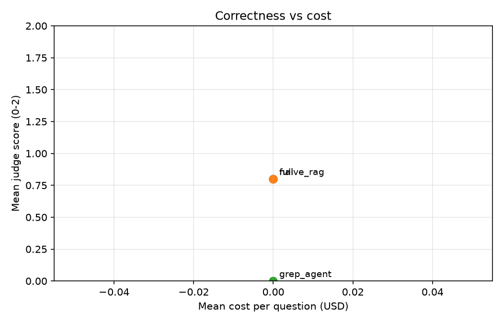
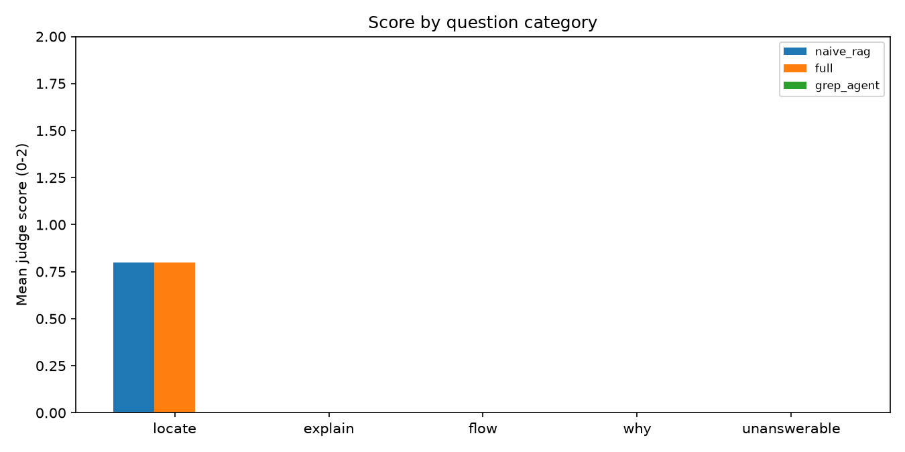

# Evaluation summary

Generated by `python -m eval.summarize` from the raw runs listed at the bottom. Scores are LLM-judge scores (0 wrong, 1 partial, 2 correct); brackets are bootstrap 95% CIs.

> **WARNING: includes MOCK runs (offline pipeline check). These numbers are meaningless.**

## Main comparison

| System | n | Mean score (0-2) [95% CI] | Correct | Refusal on unanswerable | Recall@5 | Gold-file cited | Invalid citations | Mean cost | p50 / p95 latency | Tool calls |
|---|---|---|---|---|---|---|---|---|---|---|
| naive_rag | 5 | 0.80 [0.40, 1.00] | 0% | – | 80% | 80% | 0% | $0.0000 | 0.4s / 4.7s | 0.0 |
| full | 5 | 0.80 [0.40, 1.00] | 0% | – | 100% | 80% | 0% | $0.0000 | 11.9s / 19.1s | 1.0 |
| grep_agent | 5 | 0.00 [0.00, 0.00] | 0% | – | – | 0% | 0% | $0.0000 | 0.4s / 0.4s | 1.0 |

## Ablation (adding one component at a time)

| System | n | Mean score (0-2) [95% CI] | Correct | Refusal on unanswerable | Recall@5 | Gold-file cited | Invalid citations | Mean cost | p50 / p95 latency | Tool calls |
|---|---|---|---|---|---|---|---|---|---|---|
| naive_rag | 5 | 0.80 [0.40, 1.00] | 0% | – | 80% | 80% | 0% | $0.0000 | 0.4s / 4.7s | 0.0 |
| full | 5 | 0.80 [0.40, 1.00] | 0% | – | 100% | 80% | 0% | $0.0000 | 11.9s / 19.1s | 1.0 |

## Mean score by category

| System | locate | explain | flow | why | unanswerable |
|---|---|---|---|---|---|
| naive_rag | 0.80 (n=5) | – | – | – | – |
| full | 0.80 (n=5) | – | – | – | – |
| grep_agent | 0.00 (n=5) | – | – | – | – |

## Runs

| Run | Label | Model | Judge | n | CodeAtlas version |
|---|---|---|---|---|---|
| dryrun-mock-naive_rag-requests | naive_rag | mock-llm | mock | 5 | `nogit-src-5910bc0a2c349678` |
| dryrun-mock-full-requests | full | mock-llm | mock | 5 | `nogit-src-5910bc0a2c349678` |
| dryrun-mock-grep_agent-requests | grep_agent | mock-llm | mock | 5 | `nogit-src-5910bc0a2c349678` |
